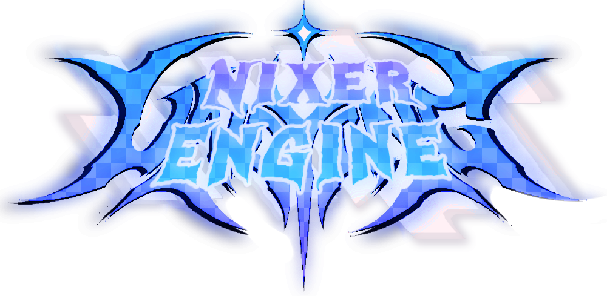

# NixerEngine

**Un motor de Friday Night Funkin' para Android, basado en Psych Engine 1.0.4 y ampliado con funciones inspiradas en V-Slice.**

---

## Acerca del proyecto

**NixerEngine** es un proyecto derivado de **Psych Engine 1.0.4**, enfocado en ofrecer una experiencia de juego adaptada a dispositivos Android y en desarrollar una identidad visual y funcional propia.

El proyecto incorpora y adapta distintas ideas y características asociadas a **V-Slice**, combinándolas con sistemas de Psych Engine y mejoras orientadas al uso móvil. No es una implementación oficial de V-Slice: es un desarrollo independiente que toma inspiración de algunas de sus funciones y de su experiencia de usuario.

NixerEngine se encuentra en desarrollo activo. Algunas características están implementadas, mientras que otras continúan en etapa de ajuste, integración o planificación.

## Características

Entre las funciones y mejoras presentes en el proyecto se encuentran:

- **Adaptación a pantallas móviles y panorámicas:** escalado uniforme para aprovechar pantallas anchas sin deformar la imagen.
- **Interfaz de Freeplay personalizada:** presentación visual propia para la selección de canciones y contenido gráfico asociado.
- **Menú de pausa personalizado:** interfaz rediseñada con información de la canción y opciones adicionales.
- **Iconos animados en Freeplay:** compatibilidad con iconos personalizados y una opción para activar o desactivar sus animaciones.
- **Opciones de jugabilidad:** ajustes heredados de Psych Engine junto con opciones incorporadas al proyecto.
- **Compatibilidad con controles táctiles:** adaptación de la experiencia de juego a dispositivos Android.

> La lista describe funciones presentes en el código del proyecto; su comportamiento y compatibilidad pueden variar según la versión y el dispositivo.

## Tecnologías

NixerEngine utiliza principalmente:

- **Haxe** — lenguaje de programación.
- **HaxeFlixel** — framework de desarrollo del juego.
- **OpenFL** — capa multimedia y de plataforma.
- **Android** — plataforma móvil objetivo.
- **Psych Engine 1.0.4** — proyecto base.

## Estado del desarrollo

El desarrollo continúa. Se están trabajando mejoras en la interfaz, la experiencia móvil, los controles, la localización y distintos sistemas del motor.

Las capturas de pantalla de los menús, las funciones adicionales y otros recursos visuales se añadirán más adelante, cuando estén preparados para mostrarse.

## Créditos y agradecimientos

- **Psych Engine** — por ser la base del proyecto.
- **V-Slice** — como referencia e inspiración para determinadas funciones y aspectos de la experiencia.
- **Haxe, HaxeFlixel y OpenFL** — por las herramientas y tecnologías que hacen posible el desarrollo.

NixerEngine es un proyecto independiente y no oficial. Los nombres y marcas mencionados pertenecen a sus respectivos propietarios.

---

**NixerEngine — En desarrollo.**

